 

 

Also: led a 5-person team on <b>Digital Journal</b> (Spring Boot · PostgreSQL · AWS S3) and owned its system design and roadmap. Every sheet on this page is a hand-drawn SVG in <a href="assets/">/assets</a>.
